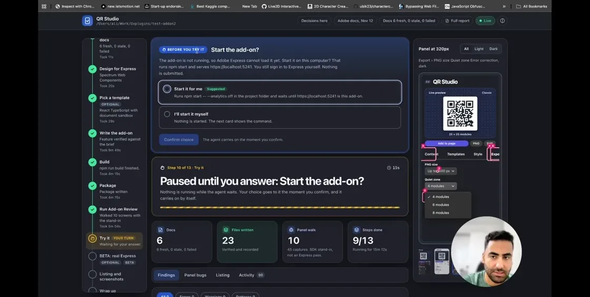

# Adobe Express Add-on Developer Assistant

**From idea to Express add-on.** Describe the tool you want to build. Shape the plan, follow the build, and try a packaged add-on in Adobe Express.

[](https://drive.google.com/file/d/1ev2h_zNWLxP5_Wcxg1FSXdD1MwDFhW5j/view?usp=sharing)

[Watch the demo](https://drive.google.com/file/d/1ev2h_zNWLxP5_Wcxg1FSXdD1MwDFhW5j/view?usp=sharing) · [Install](#install) · [How it works](#how-it-works)

## How it works

1. **Shape the idea.** Confirm the goal and the plan before project files are written.
2. **Build the add-on.** Use Adobe’s docs, select a template, and implement the feature with the right Express APIs.
3. **Check the result.** Verify the implementation, package it, and walk the panel in light and dark.
4. **Try and improve.** Load it in Express, share feedback with screenshots, and try the next build.


## What you get

- **Build on existing work.** Add a feature to a project you maintain, or start with a new add-on.
- **Follow every decision.** The local dashboard shows the plan, work in progress, captures, and feedback.
- **Prepare your listing.** Review draft marketplace copy and images before they are copied into your project.

The automated panel walk uses an SDK stand-in. Use Adobe Express to verify host behavior.

## Install

You’ll need Node.js 18 or newer and Git.

```bash
git clone https://github.com/ThisIsMrAli/addon-developer-assistant.git
cd addon-developer-assistant
node install-agents.mjs --global
```

Open a new chat in **Codex**, **Claude Code**, or **Cursor** with your project open. The installer also links supported tools such as Gemini CLI and Windsurf. Keep the checkout on disk so the links continue to work. Omit `--global` to link skills inside the checkout only.

> Use express-addon-develop to build an Express add-on that creates QR codes and adds them to the current design.

The installer links both Express skills in this checkout. Development uses the companion review scripts shipped here.

## Run from the terminal

```bash
npm run develop -- begin --dir /path/to/folder --goal "Add a caption field to the panel"
npm test
npm run test:box
```

Use a browser on the same machine for panel checks and listing captures. Set `CHROME_PATH` if needed. The optional develop beta step can open Express only after you choose Run.

See the [development workflow](.claude/skills/express-addon-develop/SKILL.md) and [companion review workflow](.claude/skills/express-addon-review/SKILL.md) for CLI steps.

## Project site

[Visit the project site](https://thisismrali.github.io/addon-developer-assistant/) for the demo, workflow, and installation guide. The Pages workflow publishes the site from `main`.

## License

[MIT](LICENSE)
